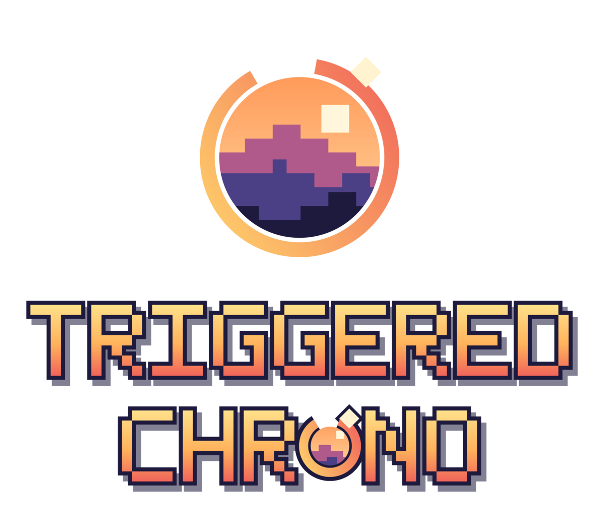

<p align="center"></p>

# Triggered Chrono

An unofficial, fan-made static recompilation of Chrono Trigger (SNES, US 1.0) into a native
PC port, built on
[ct-recomp](https://github.com/ThisIsAkill/ct-recomp) by Akhil Moola.

> **Not affiliated.** This project is not affiliated with, authorized by or endorsed by the
> rights holders of Chrono Trigger. Game and company names are trademarks of their respective
> owners and are used here only to say what the software works with. It contains no game
> code, data, art or music.

You need your own copy of the game. Put your headerless 4 MB dump in `rom/` and point
`CT_ROM` at it (see Build below). That folder is git-ignored, and no game data (ROMs,
extracted assets, keys) is ever committed to this repository.

**Players:** the [player's guide](docs/USER-GUIDE.md) covers installing the AppImage or
Flatpak, the first launch, controls, where files live and troubleshooting. On a Steam Deck or
ROG Ally, follow [docs/HANDHELD.md](docs/HANDHELD.md): Game Mode, controller-only setup,
the controls and the Deck preset. To replace the game's art with your own, or with
upscaled placeholders made from your ROM, or its music with recordings of your own, see
[docs/ASSET-PACKS.md](docs/ASSET-PACKS.md); to draw the text boxes with a font of your
choice, [HD text](docs/USER-GUIDE.md#hd-text). No art, music or font comes with it.

CI for the port (`.github/workflows/port.yml`) runs without a ROM: an engine-only build
and its tests, a check for generated code in the engine programs, the game-agnostic and
REUSE lints, and `tools/check_dist.py` on the installed engine before it is uploaded.

## License

This project is licensed under the GNU General Public License, version 3 or (at your
option) any later version: see [LICENSE](LICENSE).

It includes code under other, GPL-compatible licenses, which keeps its original notices:
ct-recomp (MIT), the zelda3 SNES core (MIT) and the ares SPC700 core (ISC). The file-by-file
map is in [REUSE.toml](REUSE.toml), the license texts are in [LICENSES/](LICENSES/), and the
details are in [THIRD_PARTY.md](THIRD_PARTY.md).

---

*The rest of this README comes from upstream ct-recomp.*

## ct-recomp

[](https://github.com/ThisIsAkill/ct-recomp/actions/workflows/ci.yml)

Static recompiler for Chrono Trigger (SNES, US 1.0) 65816 code to C, plus a C runtime.
The recompiler and runtime are game-agnostic; everything specific to Chrono
Trigger lives in `game/ct/`.

Planned features after boot (MSU-1, achievements, save states, widescreen and
more) are listed in [ROADMAP.md](ROADMAP.md).

## Progress

<!-- progress:start -->

**87.9% recompiled**: 1990 of 2263 known functions are compiled to C.

- Native at runtime: 98.0% of the instructions in a 1500-frame boot run as compiled C (the rest run in the interpreter).

Updated by `tools/progress.py` with every push; details in [game/ct/PROGRESS.md](game/ct/PROGRESS.md).

<!-- progress:end -->

## Layout

- `recomp/` — the translator (Python): decoder with static M/X tracking, C emitter.
- `runtime/` — CPU, bus, cycle model, interpreter, frame scheduler; the vendored
  PPU/DMA/APU core lives in `third_party/snes/`.
- `frontend/` — SDL2 frontend; `tools/ct_boot.c` — headless boot probe.
- `test/` — engine tests; they run on a synthetic ROM generated at build time.
- `game/ct/` — everything specific to Chrono Trigger: `game.toml` (ROM identity),
  `funcs.toml` / `unresolved.toml` (symbols), extern hooks, game tools, the
  ROM-dependent tests, and `PROGRESS.md`.

## Build

Requirements: CMake 3.20+, a C11 compiler, Python 3.11+, SDL2 (optional, for
`ct_sdl`).

Engine only (no ROM needed; what CI runs):

```
cmake -S . -B build && cmake --build build -j && ctest --test-dir build -LE rom
```

With the game. Supply your own headerless US 1.0 ROM; it is checked against
`game/ct/game.toml` at configure time:

```
export CT_ROM=/path/to/chrono_trigger.sfc   # headerless, 4 MB
cmake -S . -B build && cmake --build build -j && ctest --test-dir build
```

This builds `game/ct` (generated C goes to `build/game/ct/out/`) and two
programs at the top of `build/`. For investigations, a Debug tree builds in
about 30 seconds (runtime at `-Og`, generated code at `-O1`, see `CT_GEN_OPT`):
`cmake -S . -B build-dbg -DCMAKE_BUILD_TYPE=Debug`. The build uses ccache when
it is installed.

```
build/ct_sdl                           # play: window, audio, keyboard/controller
mkdir -p shots && build/ct_boot --frames 1500 --dump shots   # headless: PNGs of what changed
```

`ct_sdl` keys: arrows, Z=B, X=A, A=Y, S=X, Q=L, W=R, Enter=Start, Right Shift=Select;
a game controller works too. Ctrl+Q or closing the window quits.
On a touchscreen an on-screen controller appears when you touch the window
(`--touch` shows it from the start and lets the mouse press it; see
[docs/ANDROID-BUILD.md](docs/ANDROID-BUILD.md#the-touch-controller)).
`ct_sdl --record FILE` saves your pad input as a script; `ct_boot --script FILE
--frames N` replays it exactly (N is on its last line), and `ct_sdl --script
FILE` plays it back in the window. A `reset F` line in a script presses the reset button as
frame F begins. `ct_boot` also takes `--input F1-F2:BUTTONS`
to script the pad, `--wav FILE` for audio, `--hash-log FILE` for per-frame
state hashes (`tools/lockstep.py` compares native and interpreted runs with
them), and `--needed-hw FILE` to report where emulation stops.

Engine-only (`build/ct_sdl_engine`, no game code inside, see
[docs/MODULES.md](docs/MODULES.md)): started without `--module`, it finds your
ROM (`--rom FILE`, then `$CT_ROM`, then the one it used last, else it asks you
to drop the file on its window), checks it against `game/ct/game.toml`, builds
the game module from it into its preferences folder
(`~/.local/share/ct-recomp/ct/`) with a progress screen, about 40 seconds once,
and starts the game. Later runs reuse the module until the ROM or the module
ABI changes. If the build fails, a key press plays in the interpreter instead.

```
build/ct_sdl_engine --hd2d --rom /path/to/chrono_trigger.sfc
build/ct_sdl_engine --hd2d             # later: the ROM and module are remembered
```

`--data-dir DIR` points it at an installed copy of `game/` and `tools/` (default:
this source tree; packagers set `-DCT_ENGINE_DATA_DIR=...`). Before shipping a
package, `tools/check_dist.py PACKAGE --rom ROM` checks it for anything built
from the ROM, inside `.zip`, `.tar` and `.AppImage` files too.

Reference comparison: `tools/ref_compare.py --probe build/ct_boot --mesen PATH
--rom $CT_ROM --frames N [--script FILE]` runs the same input in
[Mesen 2](https://github.com/SourMesen/Mesen2) (used as a tool, headless under
`xvfb-run`, with a private settings folder) and reports the first frame where
WRAM or the picture differs, with the differing WRAM ranges.
`tools/trace_diff.py --probe build/ct_boot --mesen PATH --rom $CT_ROM --from F
--to G [--script FILE]` runs both untraced up to frame F and compares every
instruction of frames F-G (address, clock, X, Y), reporting the first
difference; about a minute for a window 12,000 frames in.
`tools/tas_convert.py MOVIE OUT` turns a TASVideos BizHawk `.bk2` or lsnes
`.lsmv` movie (from power-on) into an input script for both, resets included. Replays of a new
game into Leene Square and into the first battle are in `game/ct/test/replay/`.

The ROM is never committed, and CI never sees it.

Symbol names partly derived from dscotton/ct_disassembly (public domain) and ChronoRET.

## ROM and credits

The project's license is GPL-3.0-or-later; see [License](#license) above. The Chrono Trigger ROM and its
assets are **not included** and remain the property of their copyright
holders — you must supply your own legally obtained ROM via `$CT_ROM`.
Symbol names are credited to dscotton/ct_disassembly (public domain) and
ChronoRET. See `THIRD_PARTY.md` for vendored/adapted third-party code.

## Credits

Triggered Chrono is built on **[ct-recomp](https://github.com/ThisIsAkill/ct-recomp)** by
**Akhil Moola** (MIT licence, copyright 2026 Akhil Moola). The recompiler, runtime and much of the
frontend and test suite come from that project, and its full commit history (165 commits) is kept in this
repository. Thank you, Akhil, for the foundation this work stands on. The upstream licence text is in
`LICENSES/MIT.txt` and the details of what came from where are in `THIRD_PARTY.md` and `CREDITS.md`.
